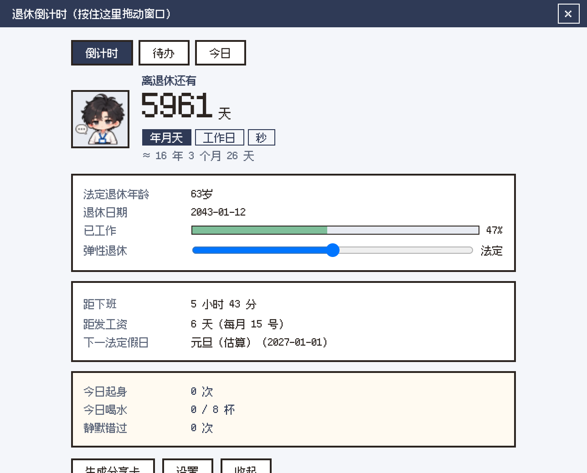
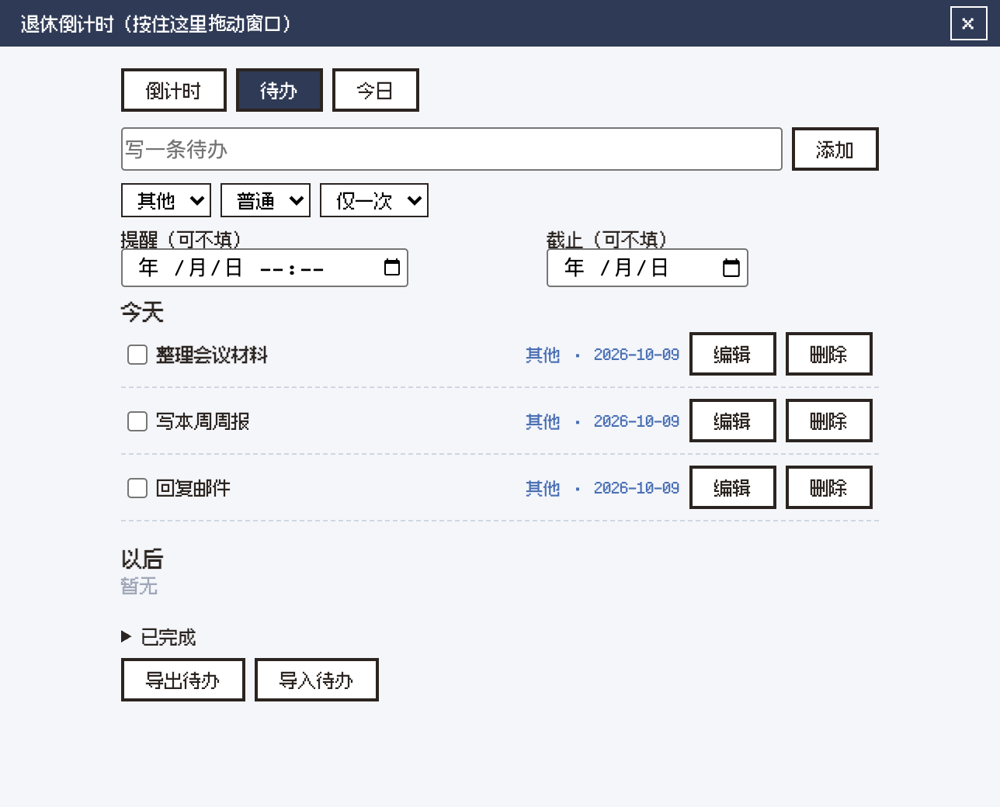

# 退休桌宠

一个离线运行的桌面小伙伴：显示退休倒计时，也能管理待办、喝水、久坐、护眼和运动提醒。

## 有什么

- 退休倒计时、脚下数字牌、悬停卡和举牌
- 待办、今日小结、分享卡
- 久坐、喝水、护眼、运动提醒；专注和午休模式
- 老板键、全屏避让、托盘、开机自启和窗口位置记忆
- 数据只保存在本机，不联网、不需要账号

## 开发

需要 Node.js、Rust 和 Tauri 的系统依赖。安装依赖后运行：

```bash
npm install
npm run tauri dev
```

测试与检查：

```bash
npm test
npx tsc --noEmit
npm run check:hair-gaps
```

## 打包

```bash
npm run tauri build
```

macOS 已验证；Windows 和 Linux 需要在对应系统完成打包和测试。

## 已知限制

- 退休日期仅作参考，请以单位人事核定为准。
- 电脑静音、合盖或系统限制时，午休提示音可能无法播放。
- 法定工作日数据随版本更新，未联网时不会自动刷新。

## 截图

| 倒计时面板 | 待办 |
|---|---|
|  |  |

| 鼠标停在小人身上：今天待办，点「完成」就消失 | 解压一下 |
|---|---|
|  |  |

截图里的日期和待办是示例数据。

## 下载安装（Windows）

在仓库的 **Releases** 页面下载 `.exe` 安装包。目前是**试用版，没有代码签名**，第一次运行会出现蓝色提示「Windows 已保护你的电脑」，点「更多信息」再点「仍要运行」即可。软件完全离线，数据只保存在你自己的电脑上。

如果安装时提示缺少 WebView2：Windows 10 较旧的版本需要先装微软的 WebView2 运行时（Windows 11 自带）。

## 许可

- **代码**：MIT 许可，见 [LICENSE](LICENSE)。
- **角色图、表情图、动画**（`public/assets/` 下，不含字体）：仅限个人使用，禁止商用和二次售卖，见 [ASSETS-LICENSE.md](ASSETS-LICENSE.md)。
- **字体**：Ark Pixel，SIL Open Font License 1.1，见 `public/assets/fonts/ark-pixel-OFL.txt`。
